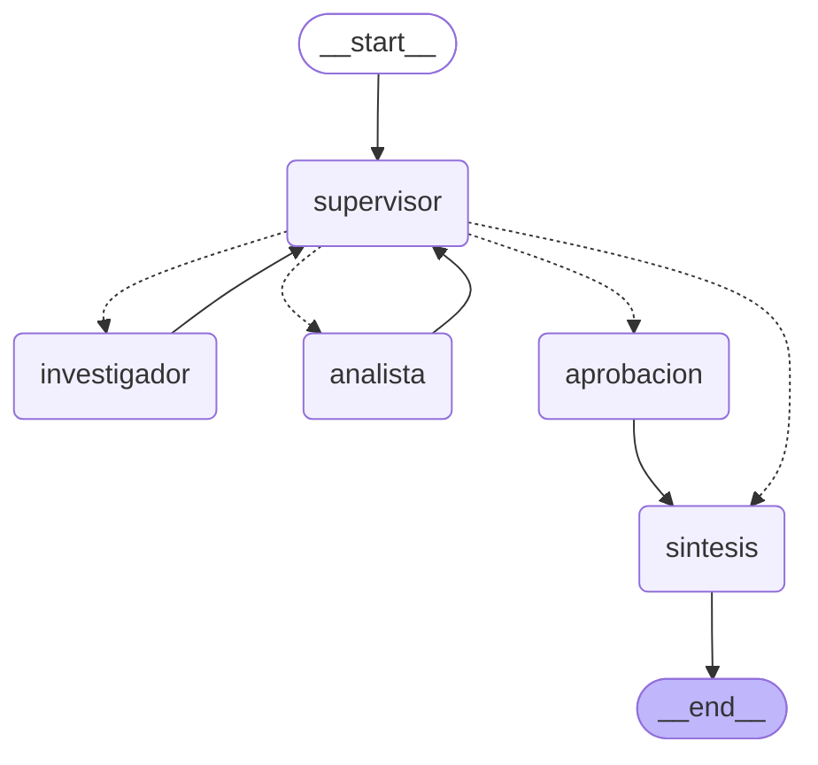

# Sistema de analisis de criticidad de equipos de planta

Sistema de IA de grado de produccion que resuelve consultas de ingenieria de
mantenimiento combinando tres capas: recuperacion sobre la documentacion real de
planta (RAG), razonamiento multi-paso mediante agentes especializados coordinados
por un supervisor, y una API REST asincrona con trazabilidad completa.

Entrega final del curso de AI Engineering (Coderhouse). Integra y refactoriza las
pre-entregas de los modulos 4 (RAG hibrido con Pinecone), 6 (orquestador
multi-agente) y 7 (API de produccion con Redis y observabilidad).

## Que resuelve

Un supervisor de mantenimiento necesita decidir si puede intervenir un equipo.
Para eso tiene que cruzar dos fuentes que viven en lugares distintos: los
manuales y procedimientos de planta, y el historico de fallas del equipo. Hoy eso
se hace a mano, consultando carpetas y planillas por separado.

El sistema responde una consulta en lenguaje natural recuperando de ambas fuentes,
calculando los indicadores de mantenimiento y emitiendo una recomendacion
operativa, con una pausa obligatoria para aprobacion humana cuando el costo
involucrado supera un umbral.

## Arquitectura del grafo

Las aristas punteadas son las condicionales que salen del supervisor; las solidas,
el retorno obligado de cada especialista.

**Supervisor** — router inteligente con salida estructurada (Pydantic). Solo puede
responder `investigador`, `analista` o `FINISH`, mas una justificacion: no hay
texto libre que interpretar. Valida contra una rubrica explicita antes de cerrar.

**Investigador** — agente ReAct con dos herramientas:
- `consultar_manuales_planta`: recupera de Pinecone los fragmentos relevantes de
  los manuales, devolviendo la fuente de cada uno (trazabilidad de proveniencia).
- `consultar_historico_fallas`: datos numericos de operacion, fallas y costos.

**Analista** — agente ReAct acotado al calculo: MTBF, MTTR, disponibilidad, costo
de indisponibilidad y clasificacion de criticidad.

**Aprobacion** — nodo human-in-the-loop. Se interpone antes de la sintesis cuando
la tarea fue clasificada como critica.

**Sintesis** — combina los aportes en un informe con recomendacion operativa.

## Capa RAG

`app/rag.py` conecta con un indice de Pinecone que contiene los manuales de
planta: mantenimiento de bomba centrifuga, procedimiento de almacenamiento y
despacho, y uso de EPP.

La recuperacion devuelve el contenido junto con la fuente de cada fragmento, de
modo que el agente pueda citar de que documento salio cada dato. El cliente y el
modelo de embeddings se cachean con `lru_cache`: se instancian una sola vez por
proceso en lugar de reconstruirse en cada consulta.

El nombre del indice, el namespace y el modelo de embeddings se leen de variables
de entorno, no estan escritos en el codigo.

## Estado compartido

`app/state.py` define `EstadoOrquestador`, que hereda de `MessagesState` y suma:

| Campo | Funcion |
|---|---|
| `next_agent` | A quien delega el supervisor en el proximo paso. |
| `contribuciones` | Registro acumulado de que agente aporto que dato. |
| `pasos` | Contador de delegaciones, para cortar bucles. |
| `task_completed` | Bandera que el supervisor levanta al validar el cierre. |
| `requiere_aprobacion` | Marca la tarea como critica. |
| `aprobacion_humana` | Decision recibida desde el endpoint de aprobacion. |

`contribuciones` usa `Annotated[list, operator.add]` como reducer: cada nodo suma
su aporte en vez de pisar el de los demas. Eso es lo que permite rastrear quien
contribuyo con que y evita la perdida de contexto entre agentes.

## API

| Metodo | Ruta | Que hace |
|---|---|---|
| `GET` | `/health` | Chequeo de disponibilidad. |
| `POST` | `/tasks` | Encola una consulta y devuelve un `job_id`. Responde 202 sin esperar. |
| `GET` | `/tasks/{job_id}` | Estado del job desde Redis. |
| `POST` | `/tasks/{job_id}/approve` | Decision humana; reanuda el grafo detenido. |

Todo el pipeline es asincrono de punta a punta (`ainvoke`, `async def`): no hay
llamadas bloqueantes dentro de los endpoints, asi que no hace falta
`run_in_threadpool`. En las pruebas, el encolado tarda menos de medio segundo
mientras la ejecucion completa lleva entre 40 y 80 segundos.

La validacion de entrada y salida es con Pydantic, incluyendo limites de longitud
en la consulta y un conjunto cerrado de decisiones validas en la aprobacion.

## Persistencia

Redis cumple dos funciones:

1. **Estado de los jobs** — lo que consulta el cliente, bajo la clave
   `job:{job_id}` con TTL de 24 horas.
2. **Checkpoints de LangGraph** — `AsyncRedisSaver` persiste el estado del grafo,
   que es lo que permite congelar una ejecucion en el nodo de aprobacion y
   retomarla despues desde el punto exacto donde se interrumpio.

Ambos comparten un unico cliente con pool y un unico checkpointer por proceso,
creados bajo un `asyncio.Lock`. Abrir conexiones por operacion agota el limite de
conexiones simultaneas; el lock evita ademas la condicion de carrera que se
produce cuando varias tareas intentan inicializar el checkpointer a la vez.

Estados posibles:

    PENDING -> RUNNING -> DONE
                       -> WAITING_APPROVAL -> RUNNING -> DONE
                       -> FAILED

El worker envuelve la ejecucion en un `try/except`: si el agente falla en segundo
plano, la excepcion se captura y el job pasa a `FAILED` con el mensaje de error,
en lugar de dejar al cliente en un bucle infinito de polling.

## Human-in-the-loop

El nodo `aprobacion` usa `interrupt()` de LangGraph. Al dispararse, el estado
queda en Redis, el run termina y el job pasa a `WAITING_APPROVAL` con el motivo y
los aportes del equipo para que un humano decida.

El criterio esta en `app/hitl.py`: se considera critica una tarea cuyo costo de
indisponibilidad supera el umbral configurado (por defecto USD 20.000). La
deteccion no depende de la redaccion exacta del modelo: se buscan con una
expresion regular todos los montos del aporte del analista y se compara el mayor
contra el umbral.

Al llamar a `POST /tasks/{job_id}/approve`, el grafo se reanuda con
`Command(resume=decision)` y la respuesta final incorpora la decision tomada.

## Validacion y control de bucles

- **Salida estructurada** en el supervisor: el LLM no puede responder algo fuera
  del conjunto permitido.
- **Calculadora segura**: parsea la expresion con `ast` y evalua solo nodos
  aritmeticos. Usar `eval()` sobre texto generado por un LLM permitiria ejecutar
  codigo arbitrario.
- **Errores informativos en vez de excepciones**: cuando una herramienta recibe un
  codigo inexistente devuelve un mensaje listando los validos, de modo que el
  supervisor pueda volver a delegar con el dato corregido.
- **`MAX_PASOS`** chequeado antes de invocar al LLM, y **`recursion_limit`** como
  red de seguridad a nivel LangGraph.

## Control de ritmo del proveedor

La capa gratuita de Gemini limita las peticiones por minuto. Con varias tareas
concurrentes disparando multiples llamadas cada una, ese limite se supera de
inmediato. `app/graph.py` lo resuelve con un semaforo y un intervalo minimo entre
llamadas: las peticiones a la API siguen siendo concurrentes, pero las llamadas al
modelo se serializan a nivel del proceso. Es el mismo patron necesario en
produccion para respetar el rate limit de cualquier proveedor.

## Observabilidad

`app/observability.py` activa el tracing de LangSmith al arrancar. Cada nodo del
grafo aparece como un span dentro de la traza del run, con sus tokens, su latencia
y su costo.

### Resultado de las 5 pruebas

| Consulta | Capas ejercitadas | Resultado |
|---|---|---|
| Criticidad del compresor C-02 | Historico + calculo | `WAITING_APPROVAL` (58,9 s) |
| Mantenimiento preventivo diario de la bomba | RAG | `DONE` (53,2 s) |
| EPP requerido segun procedimiento | RAG | `DONE` (46,7 s) |
| MTBF y disponibilidad de la bomba B-07 | Historico + calculo | `DONE` (74,8 s) |
| Renovacion de proteccion auditiva | RAG | `DONE` (50,7 s) |

Las 5 completaron sin error. La primera quedo en `WAITING_APPROVAL` porque el
costo de indisponibilidad del C-02 (USD 40.800) supera el umbral: el sistema
discrimina correctamente que tareas requieren intervencion humana y cuales no.

La latencia se concentra casi por completo en las llamadas al LLM, no en la API ni
en Redis. El nodo que mas tokens consume es el supervisor, porque interviene tres
veces por ejecucion y en cada una recibe la rubrica completa mas el historial de
contribuciones.

## Estructura del proyecto

| Archivo | Contenido |
|---|---|
| `app/main.py` | Los cuatro endpoints de FastAPI y el ciclo de vida. |
| `app/graph.py` | Orquestador multi-agente, limitador de ritmo y armado del grafo. |
| `app/rag.py` | Capa de recuperacion sobre Pinecone. |
| `app/herramientas.py` | Herramientas de los agentes, incluida la del RAG. |
| `app/hitl.py` | Nodo de aprobacion humana y criterio de criticidad. |
| `app/state.py` | Estado compartido del grafo con sus reducers. |
| `app/worker.py` | Ejecucion en segundo plano y maquina de estados en Redis. |
| `app/observability.py` | Inicializacion de LangSmith. |
| `app/config.py` | Variables de entorno y validacion explicita. |
| `test_sistema.py` | Las 5 pruebas del sistema. |
| `run.sh` / `run.bat` | Despliegue local con una sola instruccion. |

## Despliegue local

Una sola instruccion. En Linux o macOS:

    bash run.sh

En Windows:

    run.bat

El script crea el entorno virtual si no existe, instala las dependencias y levanta
la API. Antes hay que copiar `.env.example` a `.env` y completar las claves.

La documentacion interactiva queda en `http://127.0.0.1:8000/docs`.

### Redis

El proyecto se probo contra una instancia gratuita de Redis Cloud, configurada con
`REDIS_HOST`, `REDIS_PORT` y `REDIS_PASSWORD`. Para levantar uno local con Docker:

    docker run -d --name redis-planta -p 6379:6379 redis:7-alpine

Y en el `.env`:

    REDIS_HOST=localhost
    REDIS_PORT=6379
    REDIS_PASSWORD=

### Pruebas

Con la API corriendo, en otra terminal:

    python test_sistema.py

## Decisiones tecnicas

- **Sin hard-coding**: el indice de Pinecone, el namespace, el modelo de LLM, el
  de embeddings y los umbrales se leen de variables de entorno con valores por
  defecto razonables.
- **Sin efectos secundarios al importar**: `config.py` expone `validar_entorno()`
  pero no la ejecuta al cargarse. La llama la aplicacion en su ciclo de vida, de
  modo que importar el modulo para leer una constante no puede fallar.
- **Un solo checkpointer por proceso**: crear uno por tarea abre un juego nuevo de
  conexiones en cada ejecucion y agota el limite del plan gratuito.
- **Gemini en lugar de OpenAI**: expone la misma interfaz de `bind_tools()` y es
  funcionalmente equivalente para el ejercicio.

## Stack

Python 3.13 · FastAPI · Uvicorn · LangGraph · LangChain · Pinecone · Redis ·
LangSmith · Google Gemini · Pydantic · httpx · asyncio · type hints

